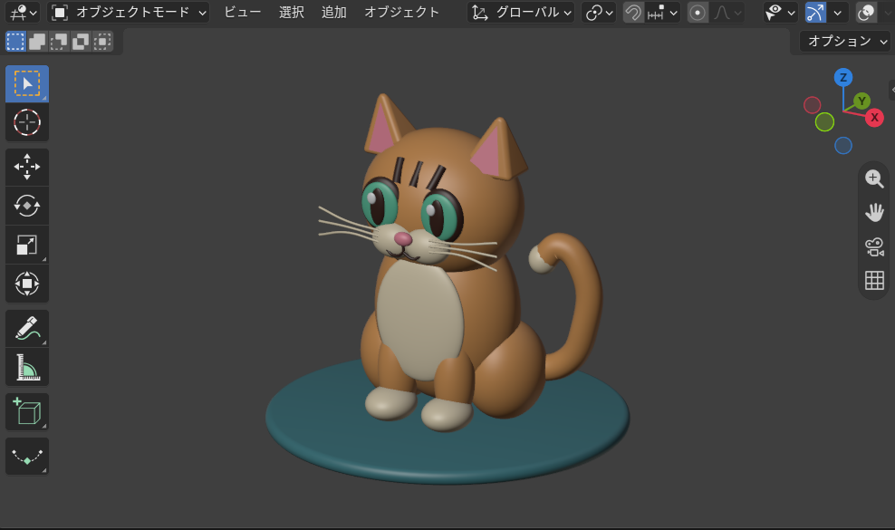

# blend_cat
3D by VibeCoding.

「CatGTP Desktop」をインストール
新しいチャットで

１．MCP for Blender インストールして

   > 勝手にインストールと設定を始める

２．ポータブル版をインストールしていたのでBlenderPortabl.exeのパスを教える

   > 起動に失敗したので、自分で起動させる 

・BlenderPortableを開く。 
・「編集 → プリファレンス → アドオン」で MCP for Blender を有効にする。 
・3D画面で N → MCP for Blender → Start MCP Server。 
・Codexを完全に終了して、再起動する。 

３．ブレンダー起動して、ChatGTPから「今開いてるブレンダーで3Dの猫作って」という

   > サクッと作ってくれたのがこのファイル

